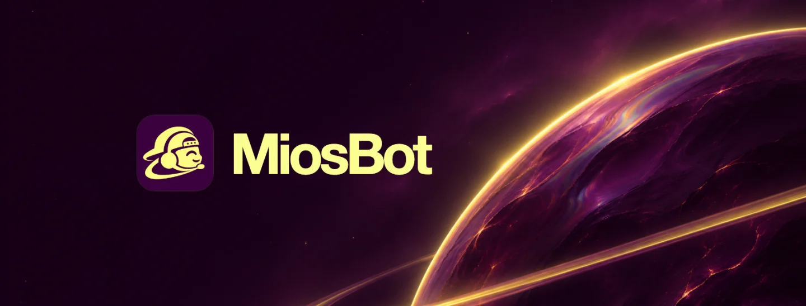

# MiosBot

Give your AI agent a task in chat, see what it’s doing beside the conversation, and step in when it needs your decision.

- **Keep the conversation going.** Return to the same chat for updates, follow-ups, and approvals.
- **Watch browser work.** Open the live browser beside chat to see where the agent clicks. If you take over, hand control back when you’re done.
- **Find the next decision.** See running tasks and requests for your input in the workspace.

[Watch the product walkthroughs](https://miosbot.com/#workspace-films)

[Product site](https://miosbot.com/) · [Documentation](https://miosbot.com/docs/) · [Support](https://miosbot.com/support/) · [Privacy](https://miosbot.com/privacy/miosbot/)

This repository contains product previews and a place for public feedback. MiosBot is developed by Apex Intelligence Inc.
