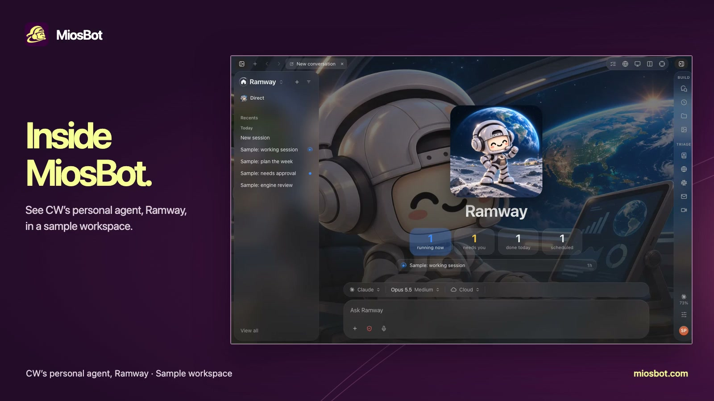

# MiosBot

**Give your AI agent the job. See it through in one conversation.**

MiosBot is an AI workspace for owners and teams. Ask it to handle a piece of work, follow the steps as it goes, and jump in when it needs a decision. The conversation keeps the request, the work, and the outcome together.

[Try the interactive demo](https://miosbot.com/#workspace-films) · [Preorder MiosBot](https://miosbot.com/contact/#preorder) · [Read the docs](https://miosbot.com/docs/)

## Give it a real job

| Ask MiosBot to | What you can see or review |
| --- | --- |
| **Draft a client follow-up** | Try the interactive example. MiosBot checks the schedule, prepares a reply, and brings it back for review in the chat. [Try it](https://miosbot.com/#workspace-films) |
| **Check a supplier’s site** | Watch the browser panel as MiosBot navigates, gathers details, and reports what it found. [Browser guide](https://miosbot.com/docs/capabilities/browser/) |
| **Turn a PDF or video into a brief** | Use built-in skills to summarize source material, or ask for a diagram of a process. [Skills guide](https://miosbot.com/docs/cloud/skills/) |
| **Repeat the way your team works** | Show MiosBot how you prepare a weekly report. Ask it to save the steps as a skill you can review and reuse. [Build a skill](https://miosbot.com/docs/cloud/skills/#add-a-new-skill) |
| **Work through a customer or sales request** | Open the request in MiosBot Teams and keep the reply and its review step with the original work. [Teams guide](https://miosbot.com/docs/world/request/) |

## Watch the work. Make the call.

Follow tasks beside the ongoing chat. When an action needs approval, review the request before deciding whether to let it run. The public demo uses sample data. For platform and connector availability, see the [product documentation](https://miosbot.com/docs/).

Have a workflow you want to try? [Tell us what you would hand off to MiosBot](https://github.com/apex-ai-co/miosbot-showcase/discussions/1).

[Product support](https://miosbot.com/support/) · [Privacy](https://miosbot.com/privacy/miosbot/)

MiosBot is proprietary software. This showcase contains public product materials and a place for feedback.
